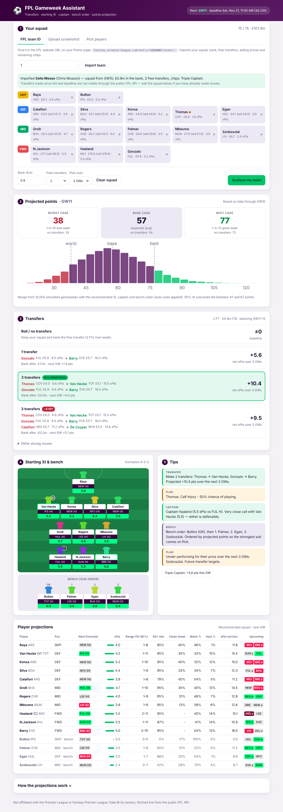

# FPL Gameweek Assistant

A web app for Fantasy Premier League managers. Load your squad and get advice for the **next gameweek**:

- **Transfers:** whether to roll, or the best 1, 2 or 3 moves, with any points hits included.
- **Starting XI:** the best formation, plus captain and vice-captain.
- **Bench order:** the first sub comes on first.
- **Points projection:** worst case, base case and best case for the gameweek.
- **Tips:** injury flags, blank and double gameweeks, rotation risk, and chip suggestions.



All numbers come from **live data in the official FPL API**: every finished gameweek's stats, the fixture list, injury news and prices.

## Three ways to enter your team

1. **FPL team ID.** Imports your squad, money in the bank, free transfers, the price you'd get for each player (purchase price and half of any rise) and the chips you have left.
2. **Upload a screenshot** of your Pick Team or Points page. Player names are read in your browser with Tesseract OCR and matched to Premier League players. Check the matches and fix any misses.
3. **Pick players** by typing their names (2 GKP, 5 DEF, 5 MID, 3 FWD, max 3 per club).

## Run it

Requires Node.js 18 or later.

```bash
npm install      # installs the OCR engine, which is served locally
npm start        # http://localhost:3000
npm test
```

Set `PORT` to change the port. On a network that needs an HTTP proxy, start the app with `NODE_USE_ENV_PROXY=1` (Node 22.21+ / 24+).

You can deploy it to any Node host (Render, Railway, Fly.io, a VPS, …). A server is needed because the FPL API doesn't allow direct requests from browsers (no CORS).

## How the model works

| Step | What happens |
| --- | --- |
| Team strength | For each club, attack and defence ratings come from every finished fixture: 65% xG, 35% actual goals. Recent games count more (half-life of 8 GWs), and the ratings are adjusted for home advantage. |
| Minutes | Start probability comes from the last 6 team fixtures. The chance of playing 60+ minutes after starting and the chance of a sub appearance are also estimated. Official injury flags scale these numbers. A regular starter who was out injured doesn't lose his projected role. |
| Per-90 rates | Goals (xG + finishing), assists (xA + actual), bonus, saves, defensive contributions and cards. Recent games count more, and players with few minutes are pulled towards the average for their position. |
| Fixture projection | Expected goals for and against in each fixture give the player's attacking returns, clean-sheet chance, goals-conceded penalty, saves and bonus. These are converted with the current FPL scoring rules (read from the API). Double gameweeks add up and blanks score zero. |
| Scenarios | 10,000 simulated gameweeks for your squad. Team-mates share clean sheets, and FPL's auto-sub, formation and captain/vice rules apply. **Worst case = 10th percentile, base case = average, best case = 90th percentile.** |
| Transfers | Every affordable single move and pair of moves is scored over your planning horizon (1–6 GWs, with later weeks weighted less). The best pairs are then extended to three moves. The search respects your budget, selling prices and the 3-per-club rule. A transfer costs 4 points beyond your free ones. Rolling a free transfer is valued at about 1.5 points. |

**Backtest** (GW5–10 of 2026/27, model fed only the data available before each gameweek): the correlation between projected and actual points per player-gameweek is 0.55, and each projection bucket is close to the actual average (for example, players projected 3–4 pts scored 3.37 on average).

## Project layout

```
server.js          HTTP server (static files + JSON API), no framework
lib/fpl.js         cached FPL API client
lib/model.js       team ratings, player rates, per-fixture expected points
lib/optimizer.js   XI / captain / bench selection, transfer search
lib/simulate.js    Monte Carlo gameweek simulation (scenarios)
lib/analyse.js     orchestration, tips, team-ID import
public/            front end (vanilla JS, no build step)
test/              unit tests (node --test)
```

### API

- `GET /api/players` returns every player with next-GW xPts, plus the next gameweek and its deadline.
- `GET /api/entry/:id` imports a team by FPL ID.
- `POST /api/analyse` takes `{ squad: [15 ids], bank, freeTransfers, horizon, sellPrices?, chipsAvailable? }` and returns the full analysis.

## Limitations

- The public FPL API only shows your squad as of the **last deadline**. If you've already made transfers this week, edit the squad after importing.
- Projections are estimates. Always check late team news and press conferences before the deadline.
- The free-transfer count comes from your transfer history under the standard rules. If FPL grants special top-ups, adjust the number in the app.

Not affiliated with the Premier League or Fantasy Premier League.
